# Steam Game Recommendation System, Clustering and Thumbnail GAN

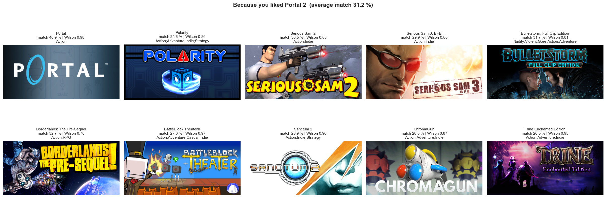

## [1/11] Overview

- **Data** → [Steam Store Games](https://www.kaggle.com/datasets/nikdavis/steam-store-games) · 27,075 games · descriptions, player tag votes (371 tags), header images · store data up to May 2019
- **Task** → recommend similar games (content-based), explain the catalogue with EDA and statistics, group it into clusters, and generate new thumbnails with a GAN
- **Metric** → recommendations: genre precision@10, same developer@10, coverage, quality, diversity · GAN: FID and a memorisation check
- **Notebooks** → `steam_recommendation_clustering.ipynb` (EDA, text mining, recommender, clusters, app) · `steam_thumbnail_gan.ipynb` (GAN)
- **App** → `app.py`: recommend, explore clusters, generate thumbnails (Gradio)
- **Result** → player tags recommend best (genre precision **0.645** vs 0.461 for descriptions and 0.215 for popularity); quality re-ranking lifts review quality from 0.605 to **0.799**; the GAN reaches FID **101.5** (plain DCGAN: 226.6) without copying its training images

| Recommender (2,000 query games) | Genre precision@10 | Same developer@10 | Coverage | Mean Wilson |
|---|---|---|---|---|
| Popularity (most rated) | 0.215 | 0.001 | 0.04% | 0.818 |
| Random | 0.252 | 0.000 | 52.4% | 0.532 |
| Descriptions, Count | 0.433 | 0.053 | 35.1% | 0.556 |
| Descriptions, TF-IDF | 0.461 | **0.076** | **45.1%** | 0.557 |
| Tags, TF-IDF | **0.645** | 0.053 | 42.2% | 0.604 |
| Hybrid (tags 50% + text) | **0.645** | 0.071 | 42.2% | 0.605 |
| Hybrid + quality re-ranking (β = 0.2) | 0.624 | 0.067 | 30.8% | 0.799 |

## [2/11] Objective

- **Business type** → gaming and entertainment (digital storefront)
- **Business objective** → help players navigate 27,000 games, raise engagement and retention, and spread attention beyond the few hits that already dominate
- **Learning problems** → item similarity (content-based recommendation), unsupervised grouping (clustering), image generation (GAN)
- **Expected result** → similarity(game attributes, the game a player liked) = match score, re-ranked by review quality
- **Use of results** → "More like this" lists and store shelves built from clusters; generated thumbnails as a creative prototype
- **Benefits** → better discovery in the long tail, insight into what players reward (and punish), and a reusable, measurable pipeline

## [3/11] Run on Kaggle

- **Titles** → Steam Game Recommendation System and Clustering · Steam Game Thumbnail Generation with a GAN
- **Import** → Create → Import Notebook → upload each `.ipynb`
- **Input** → dataset `nikdavis/steam-store-games` (mounted at `/kaggle/input/datasets/nikdavis/steam-store-games`; found anywhere under `/kaggle/input`)
- **Accelerator** → recommender: CPU, about 5 minutes · GAN: **GPU**, 100 epochs took about 18 minutes on an RTX 5060 (expect 20-40 minutes on Kaggle GPUs)
- **Internet** → needed for the header-image cards, the Gradio app link and the GAN (images come from Steam's CDN)
- **Settings** → top cell of each notebook, documented in its note
- **Safety** → `SAVE_FIGURES = False` and `LAUNCH_APP = False` → nothing is written and no app is started by default

## [4/11] Architecture

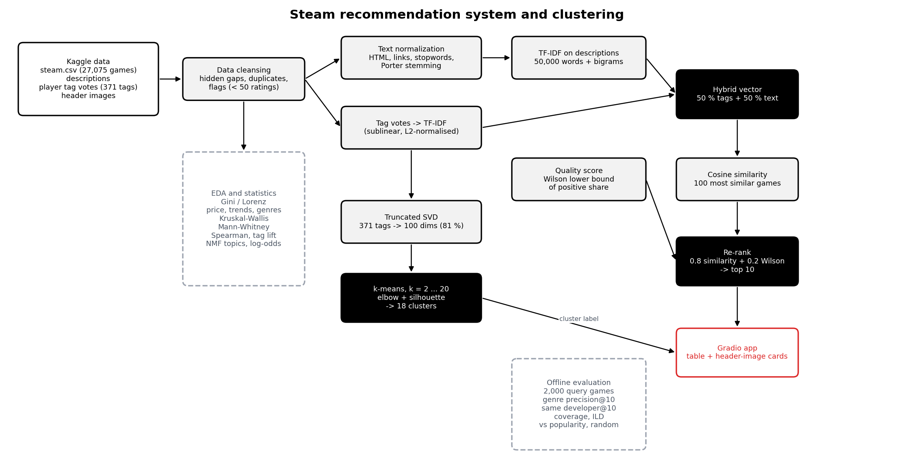

Editable sources: `assets/recommender_architecture.drawio`, `assets/gan_architecture.drawio` (open in draw.io).

## [5/11] Data cleansing

- **Kept every game** → 27,075 remain; problems are fixed or flagged, never deleted
- **Hidden gaps** → 20,905 games (77%) report a playtime of exactly 0 minutes = no data → set to missing, not zero
- **Small fixes** → 1 developer and 14 publishers missing → "unknown"; 42 duplicated names (re-releases) kept; 511 non-English games kept
- **Extreme prices** → 11 products above $100 (up to $421.99) are professional tools and simulators → real, kept
- **Thin evidence** → 15,257 games have fewer than 50 ratings → excluded only from quality comparisons (11,818 games remain for those)
- **Text** → HTML, entities and **URLs** removed: before URL removal, one description topic was just store links

## [6/11] What the catalogue says (EDA)

- **Attention is extremely unequal** → Gini 0.944 for ratings; the top 1% of games hold 63.8% of all ratings, the bottom half 0.51%
- **Experience does not buy quality** → 77.5% of 17,111 developers have one game; prolific developers are not better reviewed (p = 0.32)
- **Price** → $10–20 games review best (median positive share 0.816); free games worst (0.738, p = 1.5e-12)
- **The flood** → releases grew 170× from 2006 to 2018 while median ratings per game fell from 504 to 15
- **What players reward** → cute, visual novel, dating sim, bullet hell, great soundtrack (+0.08 to +0.11 above the median of 0.782)
- **What players punish** → massively multiplayer (−0.126), PvP, crafting, free-to-play, management, survival, sports, zombies
- **Effort signals** → Windows + Mac + Linux games 0.828 vs Windows only 0.753; achievements 0.800 vs none 0.738 (correlation, not cause)

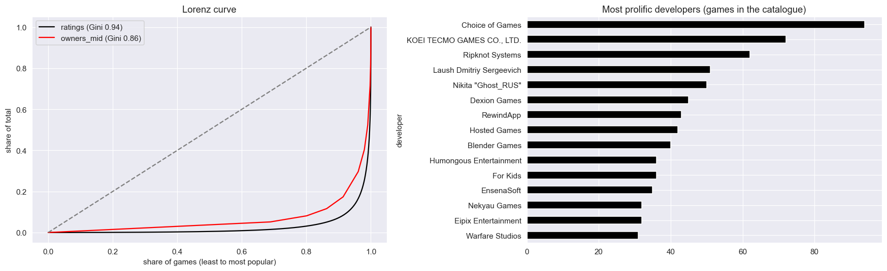

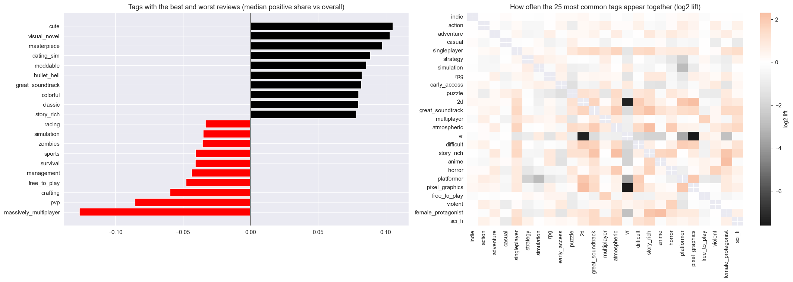

## [7/11] What the words say (text mining)

- **12 topics (NMF)** → story / visual novel, building and management simulation, online multiplayer, RPG, shooter and survival, puzzle, platformer, war strategy, space, VR, hidden-object collector editions, trivia
- **Best-reviewed topics** → puzzle (0.837), VR (0.823), story (0.820) · worst: building / management simulation (0.718)
- **Words of well-reviewed games** (log-odds z) → puzzle 13.8, girl, novel, visual novel, story, soundtrack, love, cat, music, award
- **Words of badly-reviewed games** → player −13.1, race, build, PvP, realistic, manage, car, guild, vehicle, simulation, survival
- **Insight** → descriptions that sell a story, a puzzle or a mood belong to better-reviewed games than those promising players, realism, building and survival

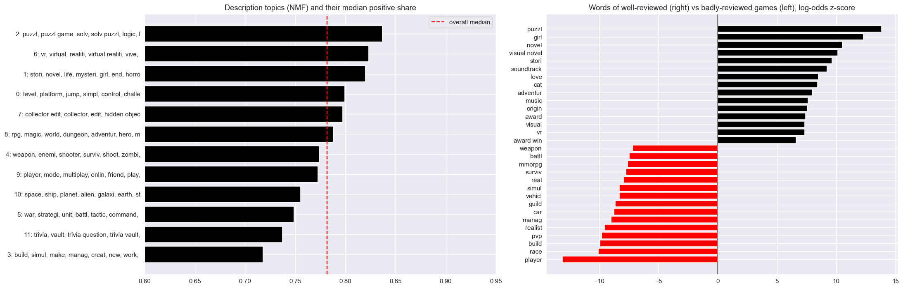

## [8/11] Recommender

- **TF-IDF vs Count** → TF-IDF wins on every relevance measure; for TF-IDF, cosine and linear kernel give identical top-10 lists (100%)
- **Tags vs descriptions** → tags match genres better; descriptions find more sequels and siblings (same developer 0.076)
- **Caveat** → store genres and player tags overlap, so the tag model's genre score is partly self-confirming
- **Quality re-ranking** → β = 0.2 lifts mean Wilson 0.605 → 0.799 for genre precision 0.645 → 0.624; coverage 42.2% → 30.8%
- **Examples** → Dark Souls III → Dark Souls Remastered, Dark Souls II, Dragon's Dogma, Skyrim · Cities: Skylines → Parkitect, Prison Architect, SimCity 4 · Portal 2 → Portal first, then shooters (puzzle games like The Talos Principle are missed)

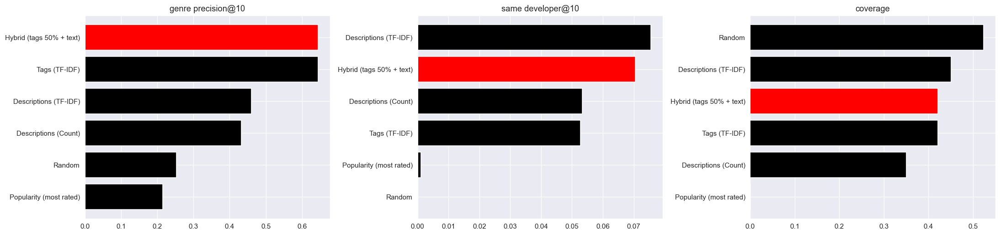

## [9/11] Clusters

- **Method** → TF-IDF tag vectors → 100 SVD dimensions (80.9% of variance) → k-means, k = 2 … 20
- **Result** → no strong natural number of groups (silhouette 0.04 → 0.10); k = 18 gives clusters that read like store shelves
- **Quality by cluster** → visual novels (median Wilson 0.714), FPS (0.690), strategy (0.685) best; casual / hidden object (0.371) weakest
- **Distinctive words** → each cluster also gets the description words that set it apart (e.g. horror: "horror, story, explore, dark")

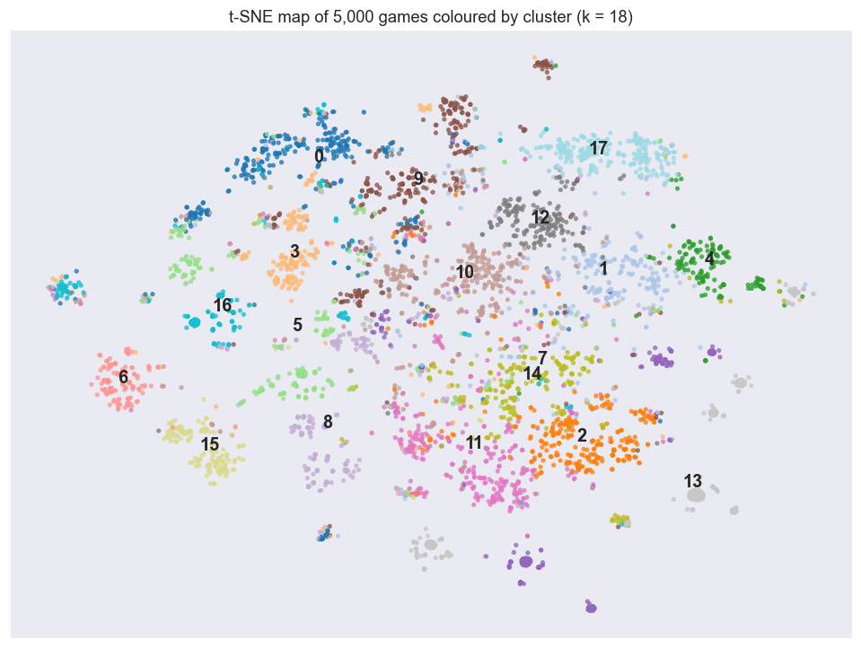

## [10/11] Thumbnail GAN

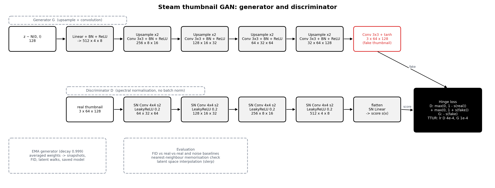

- **Data** → 11,999 Steam headers at 64 × 128 (2:1 banner shape), 2,000 held out for evaluation
- **Model** → generator with upsample + convolution (3.7 M parameters) vs spectral-normalised discriminator (2.8 M), hinge loss, two learning rates, averaged (EMA) generator weights; 100 epochs ≈ 18 minutes on an RTX 5060
- **Quality** → FID **101.5** (real vs real 25.8, random noise 379.6); the plain DCGAN first attempt scored 226.6 with checkerboard artefacts
- **No copying** → generated images sit no closer to the training set than unseen real thumbnails (similarity 0.774 vs 0.789)
- **What it learned** → banner layouts, colour moods and title-like text blocks; not readable letters or detailed characters

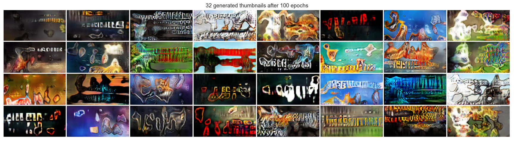

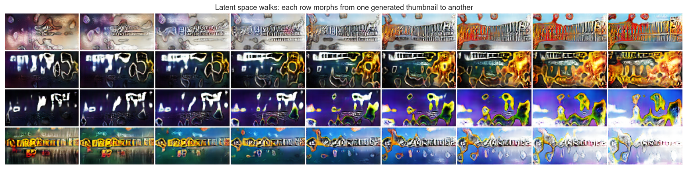

## [11/11] App and next steps

- **Run locally** → `pip install -r requirements.txt` → `python app.py`
  - data: set `STEAM_DATA_DIR` to the folder with the Kaggle CSVs, put them in `./data`, or let `kagglehub` download them (Kaggle credentials needed)
  - the index is built on first start (about 2 minutes) and cached in `./cache`; no dataset files are stored in this repository
- **Tabs** → Recommend (table + header-image cards, adjustable quality weight) · Explore clusters (top tags, distinctive words, best games) · Generate thumbnails (GAN from a seed, latent walk)
- **In the notebook** → set `LAUNCH_APP = True` on Kaggle to get a temporary public link
- **Hosting** → GitHub cannot run apps; `app.py` works as a Hugging Face Space (add the Kaggle key as a secret)
- **Next steps** → collaborative filtering with play-time or review data; learn the tag vs text weight; evaluate against real co-play data; a genre-conditioned GAN at higher resolution

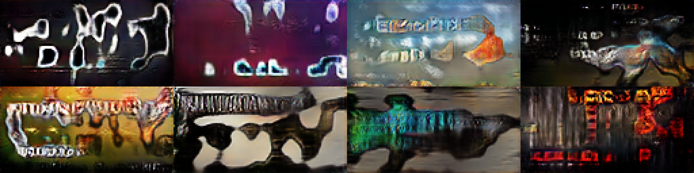

## Files

| Path | Content |
|---|---|
| `steam_recommendation_clustering.ipynb` | cleansing, EDA, statistics, text mining, recommender, evaluation, clusters, Gradio section |
| `steam_thumbnail_gan.ipynb` | thumbnail download, GAN training, FID, memorisation check, latent walks |
| `app.py`, `requirements.txt` | standalone Gradio app |
| `models/generator_ema.pt` | trained GAN generator (averaged weights) |
| `assets/` | figures and draw.io diagrams |
| `arch/` | earlier versions: content-based TF-IDF recommender and the first clustering attempt |
