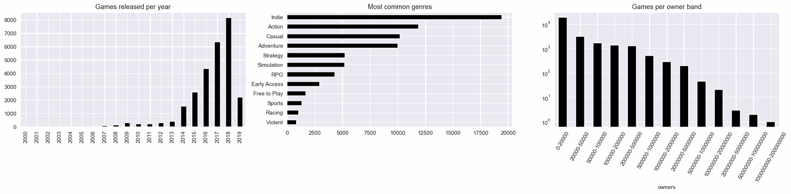
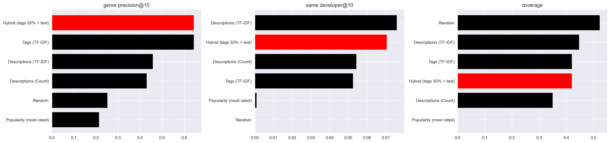
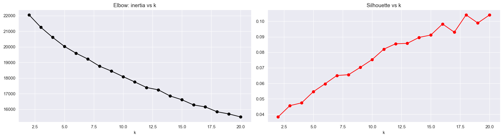

# Steam Game Recommendation System and Clustering

## [1/8] Overview

- **Data** → [Steam Store Games](https://www.kaggle.com/datasets/nikdavis/steam-store-games) · 27,075 games · descriptions + player tag votes (371 tags) · store data up to May 2019
- **Task** → recommend similar games for a game you like (content-based), and group the catalogue into clusters
- **Metric** → no user histories, so recommendations are judged offline: genre precision@10, same developer@10, catalogue coverage, quality, diversity
- **Notebook** → `steam_recommendation_clustering.ipynb`
- **Idea** → compare two signals (what developers write vs what players tag), beat a popularity baseline, re-rank by a fair quality score, then cluster the tag space
- **Result** → player tags recommend best (genre precision **0.645** vs 0.460 for descriptions and 0.215 for popularity); a 0.2 quality weight lifts review quality from 0.604 to **0.799**

| Recommender (2,000 query games) | Genre precision@10 | Same developer@10 | Coverage | Mean Wilson |
|---|---|---|---|---|
| Popularity (most rated) | 0.215 | 0.001 | 0.04% | 0.818 |
| Random | 0.252 | 0.000 | 52.4% | 0.532 |
| Descriptions, Count | 0.432 | 0.054 | 35.1% | 0.555 |
| Descriptions, TF-IDF | 0.460 | **0.076** | **44.8%** | 0.556 |
| Tags, TF-IDF | **0.645** | 0.053 | 42.2% | 0.604 |
| Hybrid (tags 50% + text) | **0.645** | 0.071 | 42.2% | 0.604 |
| Hybrid + quality re-ranking (β = 0.2) | 0.624 | 0.067 | 30.8% | 0.799 |

## [2/8] Run on Kaggle

- **Title** → Steam Game Recommendation System and Clustering
- **Import** → Create → Import Notebook → upload the `.ipynb`
- **Input** → dataset `nikdavis/steam-store-games` (mounted at `/kaggle/input/datasets/nikdavis/steam-store-games`; found anywhere under `/kaggle/input`)
- **Accelerator** → none (CPU, about 4 minutes)
- **Settings** → top cell of the notebook, documented in its note
- **Safety** → `SAVE_FIGURES = False` → nothing is written; `True` exports the charts to `WORK_DIR/assets`

## [3/8] Data and quality

- **Catalogue** → young and long-tailed: 93.2% released in 2014 or later, 71.7% Indie, 68.7% below 20,000 owners, median 36 ratings per game
- **Quality score** → Wilson lower bound of the positive share: 5/5 positive scores 0.566, 9,500/10,000 scores 0.946
  - by raw positive share the top 5 are obscure games with about 100 reviews; by Wilson, *Portal 2* and *Factorio* rise to the top

## [4/8] Text and vectors

- **Normalization** → strip HTML, lowercase, stopwords, Porter stemming → median description 250 → 115 tokens, vocabulary 89,918 → 61,950
  - 29 descriptions are empty afterwards (Russian, Chinese, Japanese, Arabic); those games still have tag vectors
- **TF-IDF vs Count** → TF-IDF wins on every relevance measure; raw counts favour long descriptions
- **Cosine vs linear kernel** → identical for TF-IDF (max difference 7e-9, same top-10 lists 100%); for raw counts only 13.7% of top-10 lists agree, and the linear kernel recommends descriptions with a median of 859 words vs 146 in the catalogue

## [5/8] Which signal recommends better

- **Tags** → best genre match (0.645) and the best-reviewed lists (mean Wilson 0.604)
- **Descriptions** → best at finding sequels and siblings (same developer 0.076): developers reuse wording and series names
- **Popularity** → shows 11 games to everyone and matches genres worse than random lists
- **Caveat** → store genres and player tags overlap, so the tag model's genre score is partly self-confirming; descriptions are judged on fully independent signals

## [6/8] Quality re-ranking

- **Score** → (1 − β) · similarity + β · Wilson, re-ranked inside the 100 most similar games
- **β = 0.2** → quality 0.604 → 0.799 (close to the popularity list's 0.818) for genre precision 0.645 → 0.624
- **Cost** → coverage 42.2% → 30.8%; at β = 0.5 quality only reaches 0.871 while coverage drops to 18.9%

## [7/8] Clusters

- **Method** → TF-IDF tag vectors → 100 SVD dimensions (80.9% of the variance) → k-means for k = 2 … 20
- **How many** → no clear elbow and a low silhouette everywhere (0.04 → 0.10): game genres overlap rather than form clean groups; k = 18 has the best silhouette with at least 4 clusters
- **Clusters** → read like store shelves: strategy, FPS, shoot-'em-up, RPG, platformer, puzzle, horror, point-and-click, visual novel, VR, racing, sports, tower defense, free-to-play MMO, simulation, casual / hidden object
- **Quality by cluster** → visual novels (median Wilson 0.714), FPS (0.690) and strategy (0.685) are best reviewed; casual / hidden object (0.371) and Early Access action (0.376) the weakest
- **Old version** → clustered on scaled numbers plus label-encoded developer ids, which gives meaningless distances

## [8/8] Examples and next steps

- **Dark Souls III** → Dark Souls Remastered, Dark Souls II, Dragon's Dogma, Oblivion, Skyrim
- **Counter-Strike: Global Offensive** → Counter-Strike: Source, Insurgency, Condition Zero, Call of Duty, Arma
- **Cities: Skylines** → Parkitect, Prison Architect, Transport Fever, SimCity 4, Planet Coaster
- **Stardew Valley** → My Time at Portia, Forager, Garden Paws, Starbound
- **Portal 2** → *Portal* first, then shooters (Serious Sam, Bulletstorm): shared first-person / co-op / sci-fi tags outweigh "puzzle", and *The Talos Principle* is missed
- **Next steps** → collaborative filtering with play-time or review data; learn the tag vs text weight; evaluate against real co-play or wishlist data instead of genre overlap

The previous versions of this project are kept in `arch/` (content-based TF-IDF recommender, and the earlier clustering attempt).
